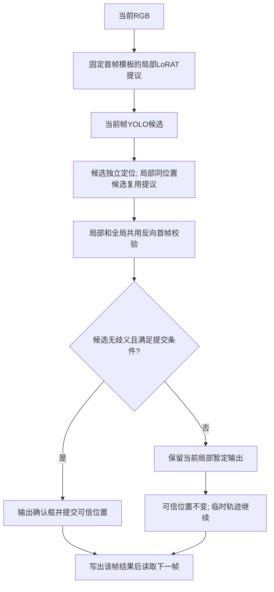

# V4：输出与状态分离，共用目标可靠性检查

状态：结构改动已实现；固定配置的32条Train前缀检查用于工程与质量诊断，完整Test420表现尚未建立。V3全量结果及其冻结实现保留。

## 改动一：独立决定当前输出与状态提交

- 正式提交通过：输出该定位，并更新可信搜索位置。
- 正式提交未通过、当前局部框数值有效：仍输出该局部框，明确标记 `tentative`；可信位置保持不变，局部临时轨迹继续推进。
- 局部数值无效、只有一个通过可靠性检查的候选组：可暂时输出候选，连续确认完成前不提交。
- 没有上述可用定位：输出 `null`，标记 `unavailable`。没有把它当作目标物理离开画面。

`bbox`、`output_source`、`localization_status` 描述当前输出；`proposed_commit`、`commit_source`、`state_committed` 描述可信状态更新。二者不再绑定。初始跟踪模板和模板mask保持固定，临时输出不写入模板。

## 改动二：正常跟踪与恢复使用同一可靠性检查

`SharedReferenceVerifier` 对局部框与全局候选使用相同条件：

1. 当前假设数值有效，前向LoRAT响应通过既有最低响应条件。
2. 将当前假设位置的图像裁剪作为**临时验证模板**，在首帧图像中反向定位。
3. 反向响应和反向框与首帧初始化框的重叠通过检查。

这是一项双向定位一致性证据，**不是身份概率，也不能保证正确目标身份**。相似目标可能仍能通过；强外观变化也可能导致正确目标被拒绝。它未被称为已验证的重识别模型。

参考图像及框只来自用户/协议提供的首帧初始化，固定不更新；验证接口不接收后续GT、视频路径、未来帧或可见性标签。反向定位使用当前候选生成的独立z、mask、image_mean和provider，复用冻结LoRAT权重。它们不替换实际跟踪器的固定模板。

正常TRACKING也检查空间不同的活动候选。只有通过上述同一检查的竞争假设能阻止提交；原始YOLO检测框单独不能否决当前局部框。多个通过检查的空间候选并存时保持歧义，不使用响应最高者强制认定身份。

连续确认仍使用已有3帧条件，所有数值参数与V3完全相同。反向检查复用已有响应下限0.5和验证IoU下限0.3；它们是未调优的工程条件，没有根据Test420扫描阈值。活动候选仍使用原有0.1检测置信度门槛，这轮没有同时改动小目标候选池。

## 当前帧流程



## 代码与运行

- `reliability_v4.py`：共用可靠性评估。
- `recovery_controller_v4.py`：候选竞争、确认、输出及提交决策。
- `causal_tracker_v4.py`：独立反向定位适配器；复用冻结V3的逐帧引擎和事务式前向推理。
- `framework_v4.json`：策略和全部既有数值参数。
- `run_tracker_v4.sh`：单视频/帧目录入口。
- `run_test420_v4.sh`：420序列入口、按序列续跑和MMOT评测。

完整Test420命令（本次开发没有启动全量推理）：

```bash
bash '/home/xu/文档/ChatGPT/uavantiuav/tracking/run_test420_v4.sh' \
  --output /home/xu/zyx/send/LORAT_YOLO_TEST420_V4_20261003
```

单序列入口与V3参数一致：`--video`或`--frames`、`--init-box x y w h`、`--output`、可选`--max-frames`及`--dry-run`。默认固定配置，没有自动搜索参数。

V4结果分别统计 `no_output_frames`、`tentative_output_frames`、`commit_deferred_frames`。有暂定输出不代表完成确认，不能只看零框数就判定跟踪成功。`reference_checks` 与 `candidate_probes` 记录增加的模型调用；速度统计包含反向校验成本。

## 验证边界

CPU状态与入口检查覆盖输出/提交独立、正常跟踪竞争检查、无效数值、错误参考返回、异常状态污染、候选断链、序列重置与续跑计数。真实模型使用固定选择的32条Train序列前缀，分别运行V3与V4，额外生成V3仅填补输出的同轨迹回放。它不是第三个独立完整跟踪实验。

真实检查逐帧核对两版本RGB一致，并核验固定模板、mask与首帧参考未修改。每条序列还检查插入一次反向定位前后的原生前向结果精确一致。完整质量及成本结果见 [本轮报告](/home/xu/文档/ChatGPT/uavantiuav/analysis/LORAT_YOLO_V4_STRUCTURAL_20261003/REPORT.zh.md)。
